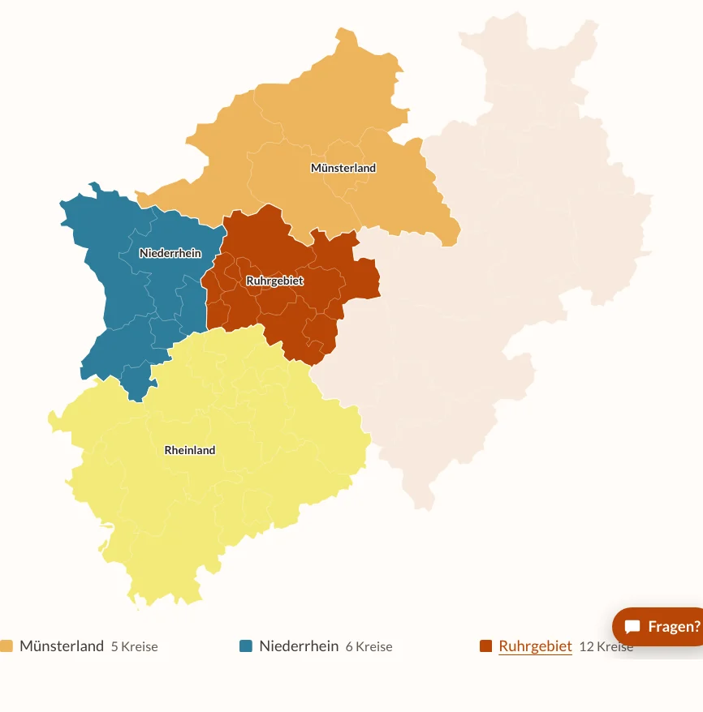
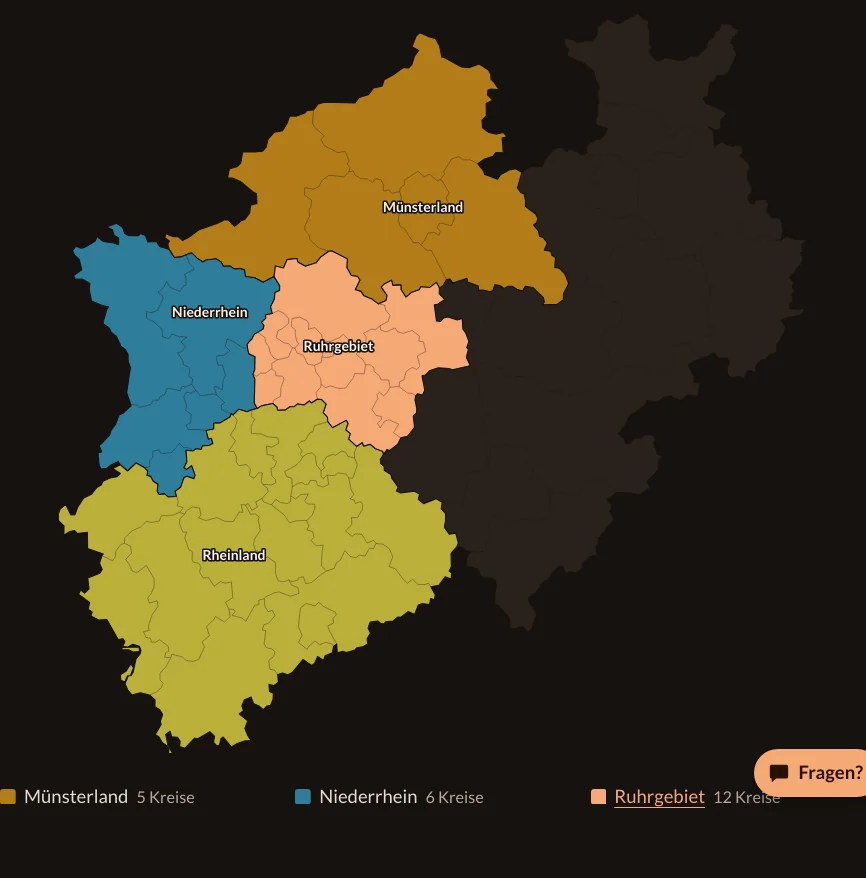
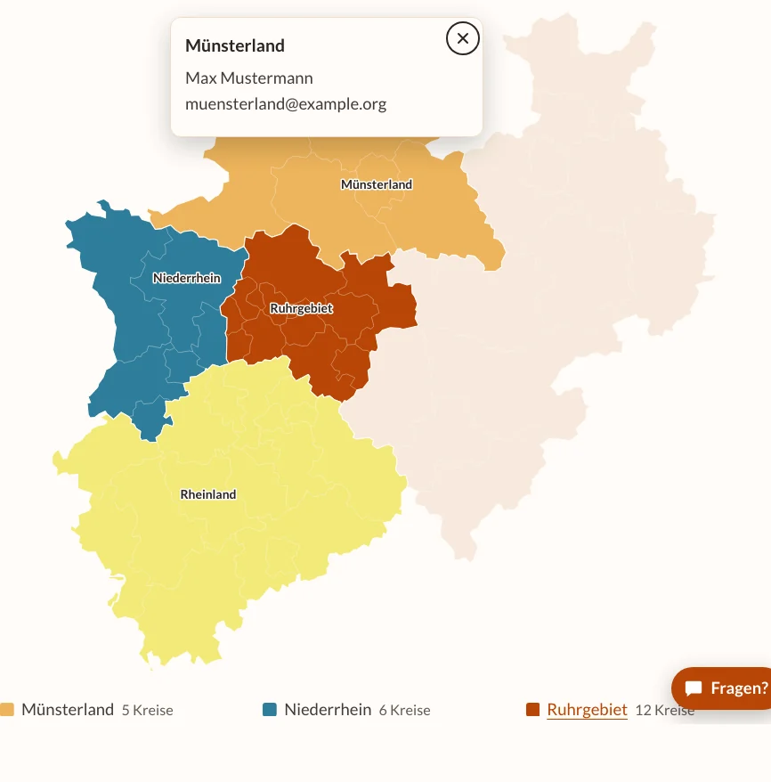
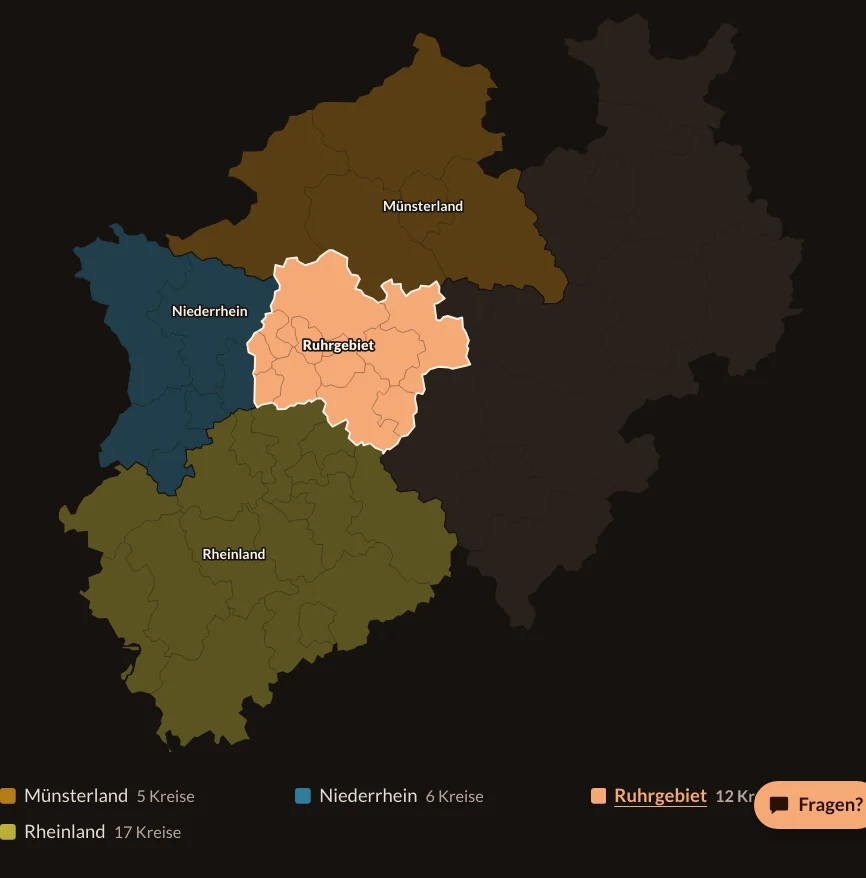
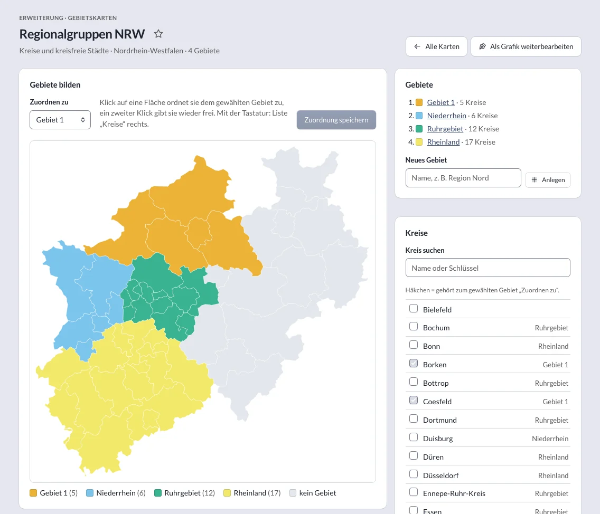
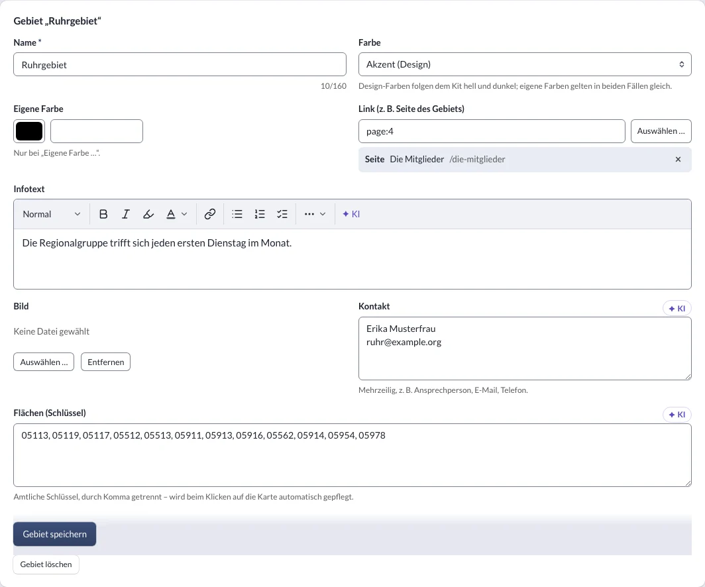
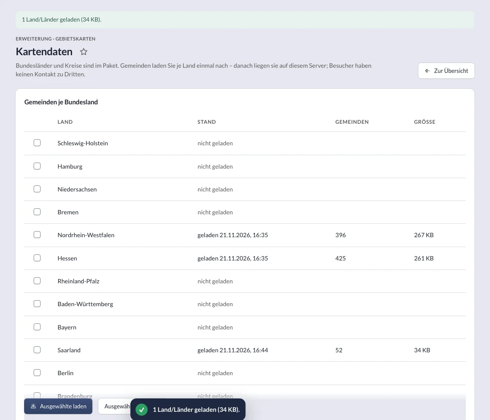
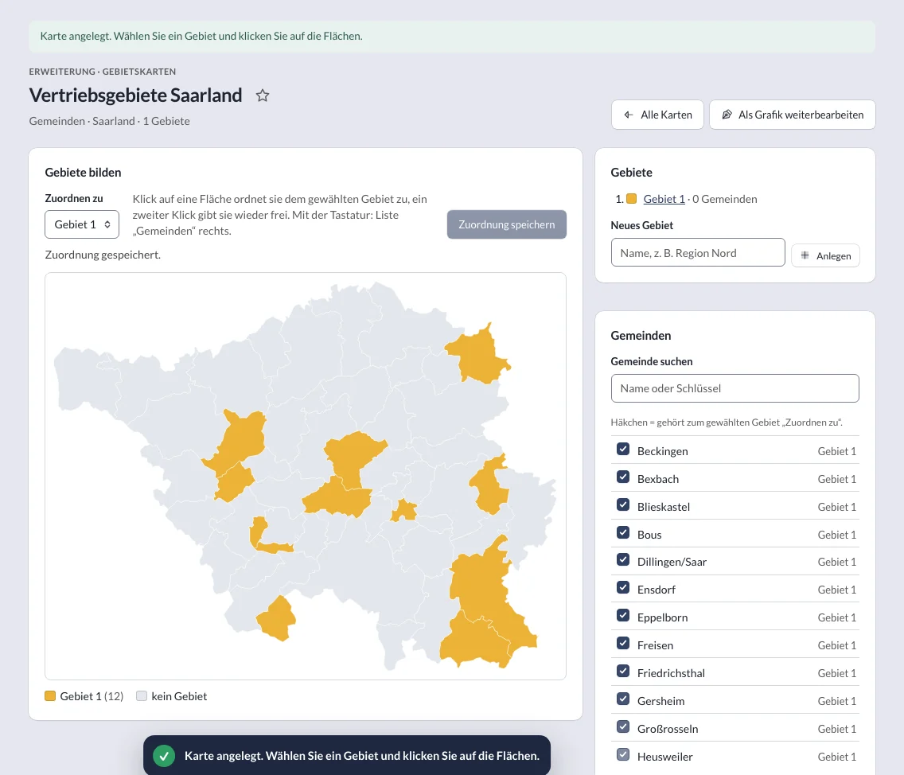
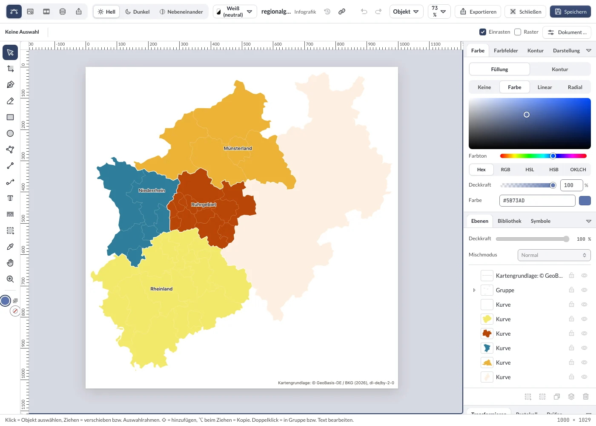

# KLXM Studio – Gebietskarten (`gebietskarten`)

Flächen einer freien Kartengrundlage zu **Gebieten** zusammenfassen und auf der Website zeigen – Regionalgruppen eines Vereins,
die Kreise eines Verbands, Vertriebsgebiete. Je Gebiet: Name, Farbe, Link, Infotext, Bild und Kontakt. Ausgabe als
serverseitig gerendertes, zugängliches SVG ohne Kartenbibliothek, ohne Kacheln und ohne Anfragen an Dritte.




Gebietskarten sind **keine Straßenkarten**: Für Standorte, Adressen und Zoomen gibt es die Karten des Cores (`Core\Maps`, MapLibre).
Hier geht es nur um Flächen und ihre Zuordnung.

## Bildschirmfotos

| | |
|---|---|
| <br>Website, hell | <br>Website, dunkel |
| <br>Info-Fenster eines Gebiets | <br>Ein Gebiet hervorgehoben |
| <br>Gebiete bilden – Klick auf die Karte oder Liste | <br>Angaben je Gebiet: Farbe, Link, Infotext, Bild, Kontakt |
| <br>Gemeinden je Bundesland nachladen | <br>Karte aus Gemeinden (Saarland) |
| <br>Als Grafik weiterbearbeiten (Paket klxm/studio-grafik) | |

Kartengrundlage in allen Bildern: © BKG (2026) dl-de/by-2-0, vereinfacht. Personen und Adressen sind erfunden.

## Installation

```bash
composer require klxm/studio-gebietskarten   # oder das Repository nach extensions/gebietskarten klonen
php bin/console extensions:publish           # gebaute Dateien nach public/assets/ext/gebietskarten
php bin/console migrate --all                # Tabellen gebietskarten_maps, gebietskarten_regions
php bin/console gebietskarten:daten --land=05   # nur für die Ebene „Gemeinden“: Kartendaten je Land nachladen
```

Einschalten je Website unter **Administration → Funktionen & Erweiterungen** oder `'extensions' => ['gebietskarten']` in
`config/sites/{key}.php`. Recht: „Gebietskarten bearbeiten“ (`gebietskarten.edit`). Benötigt KLXM Studio ≥ 1.0.0.

## Funktionen

| Bereich | Was |
|---|---|
| Kartengrundlage | Deutschland: Bundesländer, Kreise und kreisfreie Städte (im Paket), Gemeinden je Land (zum Nachladen). Ausschnitt: einzelne Länder oder ganz Deutschland. |
| Verwaltung | **Gebietskarten** im Menü: Karte anlegen, Gebiete bilden per Klick auf die Karte oder per Liste mit Suche (Tastatur), Gebiete sortieren (Ziehen, Pfeil-Knöpfe, `Alt`+`↑/↓`), Angaben je Gebiet mit Linkauswahl und Mediathek, Vorschau hell/dunkel mit den Farben des Kits und den Design-Werten der Website, Kartendaten nachladen. |
| Datentabelle | Gebiete statt hier aus einer Datentabelle: ein Eintrag = ein Gebiet, Flächen als Namen oder amtliche Schlüssel in einem Feld. **Zuordnung per Klick** schreibt das Feld der Einträge – mit den Rechten, Versionen und dem Protokoll des Cores. Auch geteilte Tabellen im Netzwerk – jede Website hebt „ihr“ Gebiet hervor (Feld „Website“). |
| Farben | Design-Farben des Kits, Palette (Okabe-Ito, erweitert; automatisch ohne Grau, Nachbarn verschieden) oder eigene Farbe – eigene Farben mit Wert **im Dunkeln** (eigenes Feld oder automatisch, Beschriftung ≥ 4,5:1). |
| „In deiner Nähe“ | Für die Blöcke Personen, Nächste Termine und Datenliste des Cores: Ort eingeben → Fläche (Gemeinde, Kreis, Land, ohne Dritte) → zuständiges Gebiet bzw. Website (Netzwerk); danach Einträge im Umkreis. |
| Block „Gebietskarte“ | Übersicht, ein Gebiet hervorheben, Gebiet dieser Seite oder Website; Klick öffnet den Link, ein Info-Fenster oder nichts. Liste der Gebiete als Alternative, Quellenvermerk unter jeder Karte. |
| Beschriftungen | Je Gebiet an/aus, eigener Text (Kurzname, Zeilenumbruch), Lage per Ziehen oder Pfeiltasten (Umschalt = große Schritte), „Lage zurücksetzen“, Hinweislinie mit eigenem Ankerpunkt für kleine Gebiete. Je Karte (und je Gebiet abweichend): Schriftgröße S/M/L oder automatisch nach Fläche, Stil automatisch hell/dunkel nach Gebietsfarbe, Schrift des Kits, dunkel, hell oder Etikett, Großbuchstaben. Kontrast hell/dunkel mit Warnung im Editor. Automatische Lage: Pol der Unzugänglichkeit (Mitte der größten freien Fläche). Bei Datentabellen Lage in der Karte, Text optional in einem Feld der Einträge. |
| Darstellung | Je Karte im Editor (Vorschau zeigt jede Änderung sofort, auch den Hover-Effekt): **Hover/Fokus** keiner, dezent (übrige Gebiete abdunkeln) oder animiert (Gebiet hebt sich weich federnd mit Schatten hervor, Name geht mit; Tastatur wie Maus, auf Touch kein Hover, bei „Bewegung reduzieren“ nur Schatten), **Schatten unter der Karte**, Beschriftungsstil **Pill hell/dunkel** (abgerundetes Etikett, auch je Gebiet) mit **Schatten der Pills**, automatische Farben als **Töne der Akzentfarbe** (Nachbarn verschieden, Kontrast der Namen ≥ 4,5:1). Kits liefern nur Standardwerte über `--gk-*`. |
| Barrierefreiheit | Jedes Gebiet ein Link bzw. Sprungziel mit Namen, sichtbarer Fokus, Liste für Screenreader und ohne JavaScript, Namen in der Karte als echter SVG-Text mit Kontrast-Rand (die zugänglichen Namen tragen die Gebiete). |
| CSP | Keine `style`-Attribute, keine Inline-Skripte: Farben als Klassen (Kit-Vertrag `--kit-*`) bzw. SVG-Attribut `fill`, Dunkel-Werte eigener Farben als erzeugte Datei im Medienordner; Skript (unter 4 KB) nur beim Info-Fenster oder Hover „animiert“ (Bewegung per Klassen, Drehpunkt per CSSOM). |
| Grafik | „Als Grafik weiterbearbeiten“: Karte als SVG in die Mediathek und – wenn das Paket `grafik` aktiv ist – gleich in den Grafik-Editor. |

**Beschriftungen auf dem Telefon:** Ist die Karte schmaler als 36rem (rund 576 px), wird die Schrift im Kartenmaß 1,6-fach (S/M/L 22/29/37 statt
14/18/23 Einheiten bei 1000 Breite) – sonst wäre sie dort kaum 7 px groß. Passt ein Name dann nicht ganz in sein Gebiet, nimmt er die nächstkleinere
Größe; passt auch S nicht (und bei Hinweislinien immer), wird er dort ausgeblendet. Die Namen bleiben an den Gebieten (Links, `<title>`) und in der Liste
zugänglich. **Bestandskarten** (angelegt vor 0.3.0) behalten Lage und Aussehen der Namen unverändert (Pixelvergleich Desktop/Telefon, hell/dunkel) – erst
„Automatisch neu setzen“ stellt sie auf die neue Lage und die Telefon-Regel um.

Befehle: `gebietskarten:daten` (Kartendaten nachladen, `--land=05,06`, `--from=URL|Ordner`, `--list`, `--remove`) und
`gebietskarten:selftest`. Doku in der Verwaltung: Handbuch → Gebietskarten, Entwicklerhandbuch → Gebietskarten (Erweiterung).

## Kartendaten, Quelle und Lizenz

| Datei | Inhalt | Größe |
|---|---|---|
| `data/de/laender.topo.json` | 16 Bundesländer | ca. 25 KB |
| `data/de/kreise.topo.json` | 401 Kreise und kreisfreie Städte | ca. 250 KB |
| Branch `data`: `de/gemeinden/{01–16}.topo.json` + `manifest.json` | 10 939 Gemeinden (inkl. gemeindefreier Gebiete), je Land 4 KB (Berlin) bis 1,2 MB (Bayern), zusammen ca. 5,7 MB | Nachladen |

- **Quelle:** Bundesamt für Kartographie und Geodäsie (BKG), *Verwaltungsgebiete 1:250 000 – VG250, Ebenen*, Stand 01.01.2026,
  [daten.gdz.bkg.bund.de](https://daten.gdz.bkg.bund.de/produkte/vg/vg250_ebenen_0101/aktuell/) (`vg250_01-01.utm32s.shape.ebenen.zip`).
- **Lizenz:** [Datenlizenz Deutschland – Namensnennung – Version 2.0](https://www.govdata.de/dl-de/by-2-0) (`dl-de/by-2-0`).
- **Quellenvermerk** (Nutzungsbedingungen des BKG für VG250, Stand 19.08.2025): `© BKG (2026) dl-de/by-2-0, Datenquellen:
  https://sgx.geodatenzentrum.de/web_public/gdz/datenquellen/datenquellen_vg_nuts.pdf` – im Web „BKG“ und „dl-de/by-2-0“ verlinkt –
  plus Veränderungshinweis. Die Erweiterung setzt ihn automatisch und überall gleich: unter jede Karte, in die Vorschau und auf „Kartendaten“
  („Kartengrundlage: © BKG (2026) dl-de/by-2-0, Datenquellen, vereinfacht“ mit Links), in Mediathek, SVG-Export und Grafik-Editor mit den
  Adressen statt Links („Kartengrundlage: © BKG (2026) dl-de/by-2-0, Datenquellen: https://sgx.geodatenzentrum.de/…, vereinfacht“).
- **Aufbereitung** (`tools/kartendaten/build.mjs`, mapshaper – nur für die Pflege, nicht im Paket): nur Landflächen, im Quellsystem
  topologieerhaltend vereinfacht (Länder 1500 m, Kreise 600 m, Gemeinden 120 m), WGS84, quantisiert. Gemeinden: eine Topologie für
  ganz Deutschland, je Land aufgeteilt mit den Bogen-Nummern der Gesamt-Topologie (`arcIds`) – Gebiete über Landesgrenzen verschmelzen lückenlos.

**Nachladen:** `php bin/console gebietskarten:daten` bzw. Gebietskarten → Kartendaten lädt aus dem Branch `data` dieses Repositorys
(`https://raw.githubusercontent.com/KLXM-Studio/studio-gebietskarten/data/de/gemeinden/`), prüft jede Datei gegen die SHA-256 im
`manifest.json` und legt sie unter `storage/gebietskarten/de/gemeinden/` ab (für alle Websites der Installation, nicht in der Sicherung).
Eigene Quelle: `'gebietskarten' => ['data_url' => 'https://…/' oder '/pfad/zum/ordner']` in der Konfiguration.

**Kartendaten neu erzeugen** (neuer Stand des BKG): ZIP laden und entpacken, dann
`cd tools/kartendaten && pnpm install && node build.mjs <ordner-mit-VG250_LAN.shp> <jahr>` – schreibt `data/de/` und
`build/data/de/gemeinden/` (Inhalt für den Branch `data`).

## English

**Area maps for KLXM Studio.** Combine the shapes of an open base map (Germany: states, districts, municipalities from the BKG VG250
dataset) into areas such as regional groups, districts of an association or sales territories, add a name, color, link, text, image
and contact per area, and show them with the “Area map” block: a server-rendered, accessible SVG without any map library or third-party
requests (strict CSP, no style attributes). Areas can also come from a data table, including shared tables across a network – assigning
shapes by clicking writes the entries' field with the core's permissions, revisions and activity log. Areas can be reordered by drag and drop
or keyboard; custom colors get a dark-mode value (own or derived with a 4.5:1 label contrast). Labels (since 0.3.0) can be set per area in the
map editor: on/off, custom text (short name, line breaks), position by dragging or arrow keys, an optional leader line with its own anchor for small
areas, font size (S/M/L or automatic by area), style (automatic light/dark by area color with contrast check, kit text, dark, light, tag) and capitals.
Automatic placement uses the pole of inaccessibility; maps created before 0.3.0 keep their label positions until “Place automatically again”.
Since 0.4.0 editors set the appearance per map, with a live preview including hover: a hover/focus effect (none, subtle – other areas dim – or animated –
the area lifts out with a soft spring and a growing shadow, its label moves along; keyboard focus like hover, no hover on touch, only a static shadow with
reduced motion), a shadow under the map, pill labels (light: kit surface and text with a fine border; dark: dark accent with light text; per map or area,
optional pill shadow) and “shades of the accent color” for automatic colors (neighbors differ, labels keep 4.5:1). Kits only provide defaults via `--gk-*`;
existing maps stay unchanged. On narrow
maps (below 36rem) labels get larger and are hidden where they do not fit; the names stay accessible on the areas and in the list. Map data:
© BKG (2026) dl-de/by-2-0 (Data licence Germany – attribution – version 2.0), simplified; the attribution is added below every map
automatically. Municipalities are downloaded per state on demand (`php bin/console gebietskarten:daten`). MIT licensed.

## Lizenz

MIT (siehe `LICENSE`) für den Code. Kartendaten: dl-de/by-2-0 (siehe oben und `THIRD-PARTY-NOTICES.md`).
